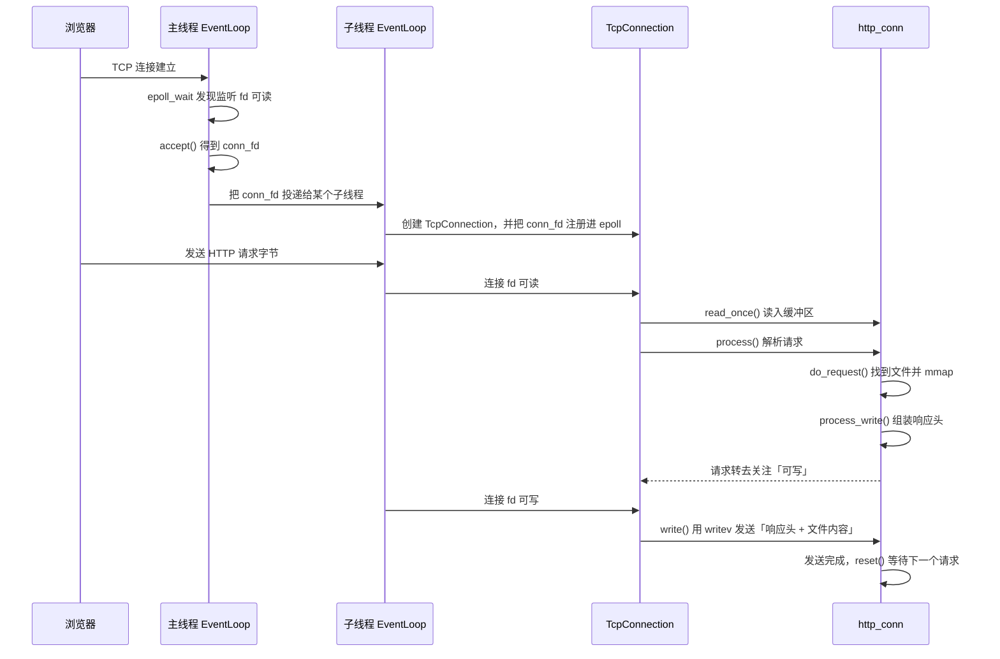

# 01 · 看懂一个 Web 服务器

> **本章讲什么**：用一个普通用户的动作——在浏览器里输入网址并按下回车——把 Web 服务器最核心的概念串起来：连接、文件描述符、HTTP 报文、`epoll`、事件循环、线程分工。
>
> **读完能回答**：
>
> - 浏览器访问一个页面时，服务器到底收到了什么、又发回了什么？
> - 文件描述符（fd）是什么？为什么服务器代码里到处是 `fd`？
> - 为什么不能「一个客户端连接开一个线程」？
> - `epoll`、事件循环、Reactor 分别在解决什么问题？
>
> **对应源码**：`main.cpp`、`webserver.cpp`、`net/`、`http/`
> **说明**：本章只建立直觉，不展开实现细节。每个概念后面都标了深入讲解的册号。

---

## 速览

1. **服务器只做三件事**：接受连接、读取请求、写回响应。
2. **连接在程序里就是一个文件描述符**（一个整数）。Linux 把 socket 也当作文件来管理，所以「读写连接」和「读写文件」用的是同一套接口。
3. **HTTP 是跑在 TCP 连接上的一段文本**：请求行、头部、空行、请求体；响应结构相同。TCP 只保证字节顺序，不保证「一条消息」的边界，所以服务器必须自己解析。
4. **一个连接一个线程的成本太高**：线程要占内存、要切换，而且大部分时间都阻塞在「等数据」上。
5. **`epoll` 让内核替服务器盯着大量连接**：哪个连接有数据可读、可写，内核就告诉服务器，服务器只处理「已经就绪」的那几个。
6. **事件循环**不断重复「问内核哪些 fd 就绪 → 调用对应处理函数」。这套结构就是 **Reactor**。
7. **本项目用多个事件循环**：主线程只负责接受新连接，子线程各自处理一批连接；一个连接从建立到关闭只属于一个线程，因此不需要为连接加锁。

---

## 一、从浏览器地址栏开始

假设你在浏览器里输入：

```
http://127.0.0.1:9006/judge.html
```

按下回车后，大致发生四件事：

```
① 找到服务器      ② 建立连接        ③ 发送请求        ④ 接收响应
DNS / IP 解析  →  TCP 三次握手   →  HTTP 请求文本  →  HTTP 响应文本
```

### 1.1 找到服务器

`127.0.0.1` 是本机地址，`9006` 是端口。真实网站还要先经过 DNS 把域名（如 `example.com`）翻译成 IP 地址。

**端口**可以理解为一栋楼里的房间号：IP 地址定位到机器，端口定位到机器上的某个程序。本项目默认监听 `9006`。

### 1.2 建立连接

浏览器和服务器之间先建立一条 **TCP 连接**。TCP 的工作是：把两边要发送的数据切成小段、编号、确认对方收到、丢了就重发，最终给上层提供一条**可靠的字节流**。

注意「字节流」三个字：TCP 只保证**字节按顺序到达**，不保证「你发一次，我就能一次收完」，也不保证「一次读到的正好是一条完整消息」。这两点会直接影响后面的服务器设计。

### 1.3 发送 HTTP 请求

连接建立后，浏览器往连接里写入一段文本：

```http
GET /judge.html HTTP/1.1
Host: 127.0.0.1:9006
User-Agent: Mozilla/5.0 ...
Accept: text/html

```

这段文本就是 **HTTP 请求**。它的结构会在 §四展开。

### 1.4 接收 HTTP 响应

服务器处理完，往同一条连接里写回：

```http
HTTP/1.1 200 OK
Content-Type: text/html; charset=utf-8
Content-Length: 12345
Connection: keep-alive

<!DOCTYPE html>
<html>...
```

浏览器读到 `200 OK` 和正文，渲染页面；页面里的图片、CSS 又会触发新的请求。**一个网页通常对应很多次 HTTP 请求**，只是它们可能复用同一条连接。

---

## 二、服务器程序的三个动作

抛开所有细节，一个 Web 服务器的主循环就是：

```text
1. 等待并接受新连接        accept
2. 从连接上读取请求字节    read
3. 解析请求、准备响应
4. 把响应字节写回连接      write
5. 处理下一个连接 / 下一个请求
```

难点不在「做哪三件事」，而在**如何同时服务成千上万个连接**。这就是并发模型要解决的问题（见 [07](07-并发模型重构.md)）。

---

## 三、socket 与文件描述符

### 3.1 什么是 socket

**socket（套接字）** 是操作系统提供给应用程序的网络通信端点。你可以把它想成一根电话线的两端：两端各有一个 socket，一端写入的字节会从另一端读出来。

服务器创建监听 socket 的步骤大致是：

```cpp
int listen_fd = socket(AF_INET, SOCK_STREAM, 0);   // 创建 socket
bind(listen_fd, ...);                              // 绑定 IP 和端口
listen(listen_fd, ...);                            // 开始监听
int conn_fd = accept(listen_fd, ...);              // 接受一个客户端连接
```

这几行背后，TCP 三次握手已经由**内核**完成。应用程序看到的结果只是：`accept()` 返回了一个新的整数 `conn_fd`，代表「与这个客户端之间的一条连接」。

### 3.2 文件描述符是什么

上面出现的 `listen_fd`、`conn_fd` 都是**文件描述符**（file descriptor，简称 fd）——一个**非负整数**。

Linux 的设计是「一切皆文件」：普通文件、目录、管道、终端、socket，在进程里都用一个 fd 来代表。fd 可以理解为：

> **进程与内核对象之间的一个编号。** 进程拿着这个编号，请求内核替自己对该对象做操作。

内核为每个进程维护一张「fd → 内核对象」的对照表。`fd = 0/1/2` 默认分别是标准输入、标准输出、标准错误；程序打开一个文件或接受一个连接，内核就分配一个当前空闲的编号。

因此服务器代码里经常看到：

```cpp
read(conn_fd, buf, size);      // 从连接读
write(conn_fd, data, len);     // 往连接写
close(conn_fd);                // 关闭连接（本质是关闭这个 fd）
```

**同一个 fd 编号在关闭后可能立刻被内核分配给新连接。** 这一点在后面会反复出现：迟到的 `epoll_ctl` 或 `close` 如果作用到已被复用的编号上，就会误伤另一条连接（见 [09](09-生命周期与资源管理.md)）。

### 3.3 一次连接的完整生命周期

```text
监听 fd（一直存在）
   │
   ├─ accept() → 连接 fd A → 读请求、写响应 → close(fd A)
   ├─ accept() → 连接 fd B → ...
   └─ accept() → 连接 fd C → ...
```

监听 fd 负责「接客」，每接到一个客户端就产生一个新的连接 fd。**监听 fd 和连接 fd 是两类不同的东西**，后面讲事件注册时会区分它们。

---

## 四、HTTP 报文长什么样

HTTP 是**文本协议**。客户端和服务器互相发送的就是一段有格式的文本。

### 4.1 请求

```http
GET /judge.html HTTP/1.1
Host: 127.0.0.1:9006
Accept: text/html
Content-Length: 0

```

| 部分 | 内容 | 含义 |
|:--|:--|:--|
| **请求行** | `GET /judge.html HTTP/1.1` | 方法、路径、协议版本 |
| **头部** | `Host: ...` 等 | 附加信息，一行一个「键: 值」 |
| **空行** | `\r\n` | 头部结束的标志 |
| **请求体** | 空行之后的内容 | `GET` 通常没有；`POST` 的表单、上传文件放在这里 |

### 4.2 响应

```http
HTTP/1.1 200 OK
Content-Type: text/html; charset=utf-8
Content-Length: 12345

<!DOCTYPE html>...
```

| 部分 | 内容 | 含义 |
|:--|:--|:--|
| **状态行** | `HTTP/1.1 200 OK` | 协议版本、状态码、原因短语 |
| **头部** | `Content-Type` 等 | 正文类型、长度、连接是否保持 |
| **空行** | `\r\n` | 头部结束 |
| **正文** | 文件内容 / 错误文本 / 动态页面 | 真正要给客户端的数据 |

### 4.3 为什么解析报文是服务器的一大工作

TCP 是字节流，内核不会告诉你「这是一条完整的 HTTP 请求」。一次 `read` 可能：

- 只读到半行请求行；
- 读到完整的请求头，但请求体还没到；
- 一次读到两个完整请求（HTTP 管线化）。

因此服务器必须**把收到的字节缓存起来，按 `\r\n` 切行，逐段解析，并记住「解析到哪一步了」**。这就是状态机解析器存在的原因（见 [10](10-协议实现.md)）。

### 4.4 常见方法与本项目的支持范围

| 方法 | 用途 | 本项目 |
|:--|:--|:--|
| `GET` | 获取资源 | 支持 |
| `HEAD` | 只要响应头，不要正文 | 支持 |
| `POST` | 提交数据（登录、注册、上传） | 支持 |
| `PUT` / `DELETE` / `OPTIONS` 等 | 其他语义 | 返回 `501 Not Implemented` |

---

## 五、如果每个连接开一个线程

### 5.1 最直观的做法

一个初学者很容易写出这样的结构：

```cpp
while (true) {
    int conn_fd = accept(listen_fd, ...);
    std::thread t([conn_fd] {
        char buf[4096];
        read(conn_fd, buf, sizeof(buf));   // 阻塞，直到有数据
        // 解析、处理、write
        close(conn_fd);
    });
    t.detach();
}
```

逻辑是清楚的：每个客户端一个线程，各干各的。连接少的时候完全没问题。

### 5.2 连接多了会怎样

问题出在 `read()` 的**阻塞**语义：没有数据时，线程会被内核挂起，直到数据到达。一个 Web 连接绝大多数时间都在「等」：等用户思考、等网络传输、等下一个请求。

于是：

| 成本 | 说明 |
|:--|:--|
| **内存** | 每个线程要有自己的栈（通常几 MB 的虚拟内存） |
| **切换开销** | 线程数一多，CPU 大量时间花在上下文切换上 |
| **可扩展性差** | 一万个空闲连接就是一万个阻塞线程，机器先被线程压垮 |

这就是经典的 **C10K 问题**：如何让单机同时处理上万个连接。答案不是「开更多线程」，而是**不要为每个连接保留一个等待中的线程**。

---

## 六、epoll：让内核替你盯着所有连接

### 6.1 核心思路

与其让 N 个线程各自阻塞在 N 个连接上，不如：

> **把所有连接交给内核看管；哪个连接有事件（可读 / 可写），内核就通知应用程序，应用程序只处理这几个连接。**

Linux 提供的机制叫 **`epoll`**。它有三个操作：

| 操作 | 作用 |
|:--|:--|
| `epoll_create1()` | 创建一个 epoll 实例（可以理解为一块「关注列表」） |
| `epoll_ctl()` | 往列表里添加（`ADD`）、修改（`MOD`）、删除（`DEL`）一个 fd 和关心的事件 |
| `epoll_wait()` | 阻塞等待，直到列表里有 fd 就绪，返回就绪的 fd 列表 |

一个线程可以只用一个 `epoll_wait()` 同时管理几千个连接，因为这些连接**没有各自占着一个线程在等**。

### 6.2 一个生活化的类比

- **阻塞 IO + 每连接一线程**：每个客户配一个服务员，服务员站在桌边等客户点菜，客户不点就一直站着。
- **epoll**：所有桌子装一个呼叫铃，服务员在前台等。哪个桌子按铃，前台就告诉服务员「3 号桌、7 号桌有需求」，服务员只去这两桌。

### 6.3 水平触发与边沿触发

`epoll` 有两种通知方式：

| 模式 | 行为 | 类比 |
|:--|:--|:--|
| **LT（水平触发）** | 只要 fd 上还有数据没读完，每次 `epoll_wait` 都会继续通知 | 信箱里有信就一直提醒你 |
| **ET（边沿触发）** | 只在「状态发生变化」时通知一次；没读完也不会再提醒 | 只在信投进去的那一刻响一次铃 |

ET 效率更高，但要求应用程序**一次把数据读到没有为止**（读到返回 `EAGAIN`），否则剩下的数据可能永远等不到下一次通知。本项目默认使用 LT+LT，同时支持通过 `-m` 切换组合（见 [07](07-并发模型重构.md)）。

### 6.4 非阻塞 IO 与 EAGAIN

在事件驱动模型里，读操作通常要设成**非阻塞**：

- 有数据：`read` 返回读到的字节数；
- 暂时没数据：`read` 立刻返回 `-1`，`errno` 为 `EAGAIN`（或 `EWOULDBLOCK`），而不是把线程挂起。

这样事件循环才能「有事件就处理，没事件就继续等」，不会被某一个连接卡住。

---

## 七、事件循环与 Reactor

### 7.1 事件循环

把 `epoll_wait` 放进一个 `while` 循环，就得到了**事件循环**：

```text
while (没有要求退出) {
    就绪列表 = epoll_wait(...)        // 等内核通知
    for (fd : 就绪列表) {
        调用这个 fd 对应的处理函数     // 读 / 写 / 关闭
    }
    执行其他线程投递过来的任务
}
```

一个线程跑一个这样的循环，就是这个线程的**事件循环**（`EventLoop`）。

### 7.2 Reactor 模式

**Reactor** 是这类结构的通用名字，核心角色只有三个：

| 角色 | 本项目中的类 | 职责 |
|:--|:--|:--|
| **事件分发器** | `EventLoop` | 等事件、把事件分发给对应处理者 |
| **事件源绑定** | `Channel` | 记录「这个 fd 关心什么事件、就绪后调用谁」 |
| **事件处理器** | `TcpConnection` / `http_conn` | 真正读数据、解析请求、生成响应 |

服务器启动后，主循环就在「等事件 → 分发 → 处理 → 再等」中不断循环，直到收到退出信号。

### 7.3 one loop per thread

如果所有连接都在一个事件循环里处理，一个事件循环线程仍然可能成为瓶颈（尤其当处理逻辑里有数据库查询等耗时操作时）。

本项目的做法是：

- **主线程**：一个事件循环，只负责 `accept` 新连接；
- **子线程**：每个子线程一个事件循环，各自管理一批已建立的连接；
- 新连接按轮转顺序分给某个子线程，之后这条连接的所有事件都在那个线程处理。

这套结构叫 **主从 Reactor**，线程模型叫 **one loop per thread**（一个线程一个事件循环）。

它带来的最重要的性质不是「多线程跑得快」，而是：

> **一条连接的 fd、解析状态、超时定时器，全部只属于一个线程。** 于是不需要为连接状态加锁，也不存在两个线程同时读写同一条连接的问题。

这条「连接归属」约定是第 [07](07-并发模型重构.md) 册的核心。

---

## 八、数据库和日志在服务器里的位置

Web 服务器除了收发字节，通常还要做两件事：

### 8.1 数据库

注册、登录需要把用户信息存进 MySQL、再查出来。每次请求都新建一个数据库连接代价很高（TCP 连接 + 身份认证），所以本项目使用**连接池**：启动时建好若干条连接，请求来了借一条，用完归还。详见 [04](04-注册与登录.md)。

### 8.2 日志

服务器需要记录「收到了什么请求、发生了什么错误、当前有多少连接」。日志写得太慢会拖慢请求处理，写得太随意又可能在崩溃时丢掉关键信息。本项目为此专门设计了同步/异步两种写入方式和缓冲池批量落盘。详见 [06](06-日志系统.md)。

---

## 九、本项目的一次请求之旅

把上面的概念合起来，一次 `GET /judge.html` 在本项目中的路径是：



每一步的细节分别在第 [03](03-静态资源服务.md)、[07](07-并发模型重构.md)、[10](10-协议实现.md) 册展开。

---

## 十、概念地图

| 你会反复看到的概念 | 一句话解释 | 深入 |
|:--|:--|:--|
| **fd / 文件描述符** | 进程用来访问内核对象的整数编号 | 本章 §三、[09](09-生命周期与资源管理.md) |
| **socket** | 网络连接的端点，在程序里同样用 fd 表示 | 本章 §三 |
| **TCP** | 提供可靠、有序字节流的传输层协议 | 本章 §一 |
| **HTTP** | 跑在 TCP 上的文本协议，规定请求/响应格式 | 本章 §四、[10](10-协议实现.md) |
| **系统调用** | 应用程序请求内核替自己做事的接口，如 `read`、`write`、`epoll_wait` | 本章 §三 |
| **阻塞 / 非阻塞** | 没数据时是挂起等待，还是立刻返回 `EAGAIN` | 本章 §五、§6.4 |
| **epoll** | 内核代管大量 fd，只通知已就绪的那些 | 本章 §六、[07](07-并发模型重构.md) |
| **LT / ET** | 持续通知 / 只在状态变化时通知 | 本章 §6.3 |
| **Reactor** | 「等事件 → 分发 → 处理」的服务器结构 | 本章 §七、[07](07-并发模型重构.md) |
| **one loop per thread** | 每个线程一个事件循环，连接归属唯一线程 | 本章 §7.3、[07](07-并发模型重构.md) |
| **timerfd** | 把「定时到点」变成 fd 可读事件 | [08](08-事件源统一.md) |
| **eventfd** | 用一个 fd 做跨线程唤醒 | [07](07-并发模型重构.md)、[08](08-事件源统一.md) |
| **signalfd** | 把进程信号变成 fd 可读事件 | [08](08-事件源统一.md) |
| **mmap** | 把文件映射到进程地址空间，访问映射区即访问文件内容 | [03](03-静态资源服务.md)、[09](09-生命周期与资源管理.md) |
| **writev** | 一次系统调用写出多段不连续的数据 | [03](03-静态资源服务.md) |

---

## 十一、通用知识

**网络与协议**

- **TCP 提供的是字节流，不是消息流**：应用层必须自己定义「一条消息到哪里结束」（HTTP 用 `Content-Length`、空行、边界字符串等）
- **端口用于区分同一台机器上的不同服务**；监听 socket 与连接 socket 是两类 fd
- **HTTP/1.1 默认保持连接**：一个 TCP 连接上可以依次处理多个请求，减少重复建连
- **HTTP 方法、状态码、头部字段**构成协议语义；`GET` 取资源、`POST` 提交数据、`HEAD` 只要头部

**Linux 系统编程**

- **文件描述符是进程级编号**，关闭后会被内核复用；任何以 fd 作为长期身份标识的设计都要警惕复用问题
- **阻塞 IO 会在没有数据时挂起线程**；非阻塞 IO 返回 `EAGAIN`，适合事件驱动
- **`epoll` 解决的是「大量连接中找出少数就绪者」的问题**，不是「让单个操作更快」
- **`epoll_wait` 返回的是「就绪」，不是「完成」**：数据还需要应用程序自己读走

**架构**

- **事件驱动 + 事件循环**是单线程处理大量连接的基础；多线程扩展时，关键是划分清楚「谁拥有哪些对象」
- **Reactor 的三个角色**：分发器、事件源绑定、处理器；理解这三个角色，后面看任何网络库都不会陌生
- **并发模型的首要目标是结构清晰**：先保证「同一对象只被一个线程访问」，再谈性能

---

## 十二、延伸阅读

| 想继续了解 | 去看 |
|:--|:--|
| 本项目的功能与代码分层 | [02 · 项目总览](02-项目总览.md) |
| 静态页面如何被找到并发送 | [03 · 静态资源服务](03-静态资源服务.md) |
| 连接如何被分配到线程、如何避免竞争 | [07 · 并发模型](07-并发模型重构.md) |
| HTTP 报文如何被解析 | [10 · 协议实现](10-协议实现.md) |
| 术语速查 | [15 · 附录](15-附录.md) |

---

**下一册**：[02 · 项目总览](02-项目总览.md) —— 这个项目实现了哪些功能、代码分成哪几层、启动时按什么顺序初始化。
