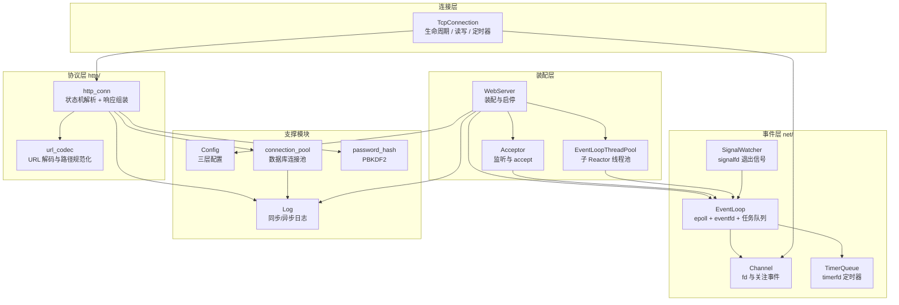
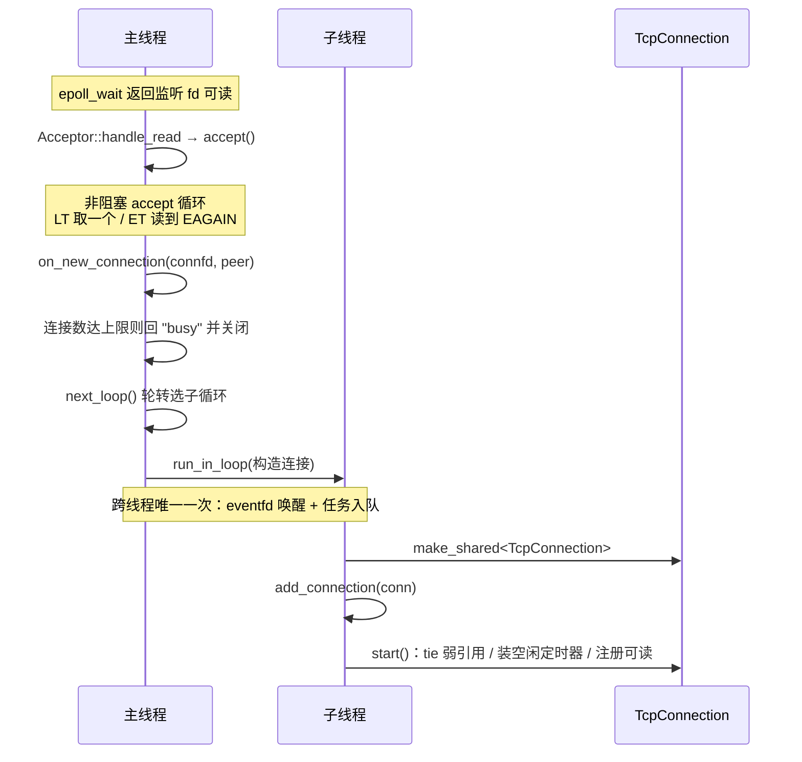
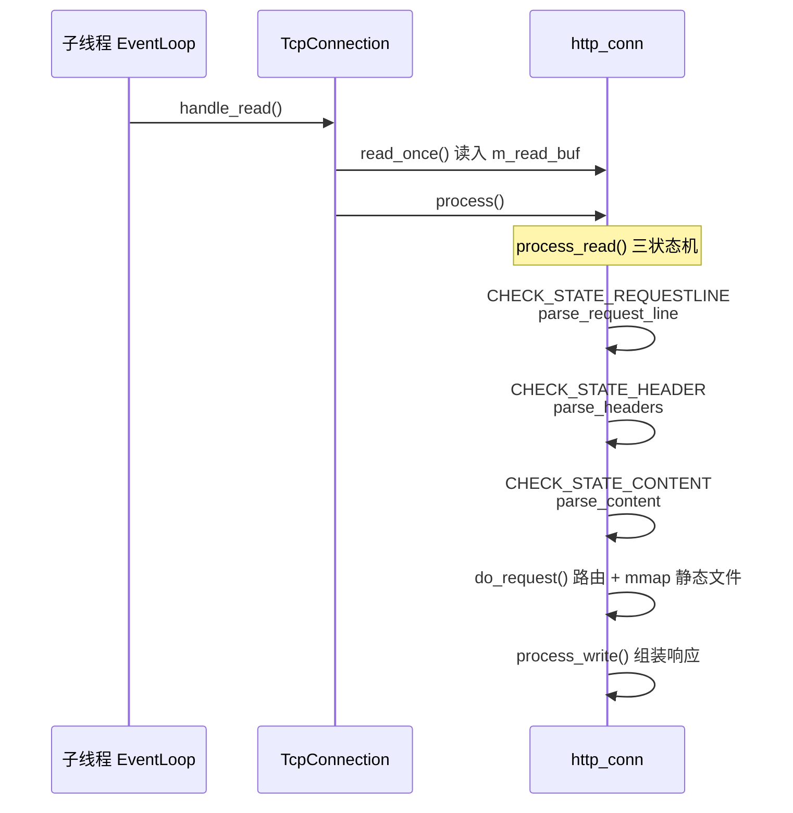
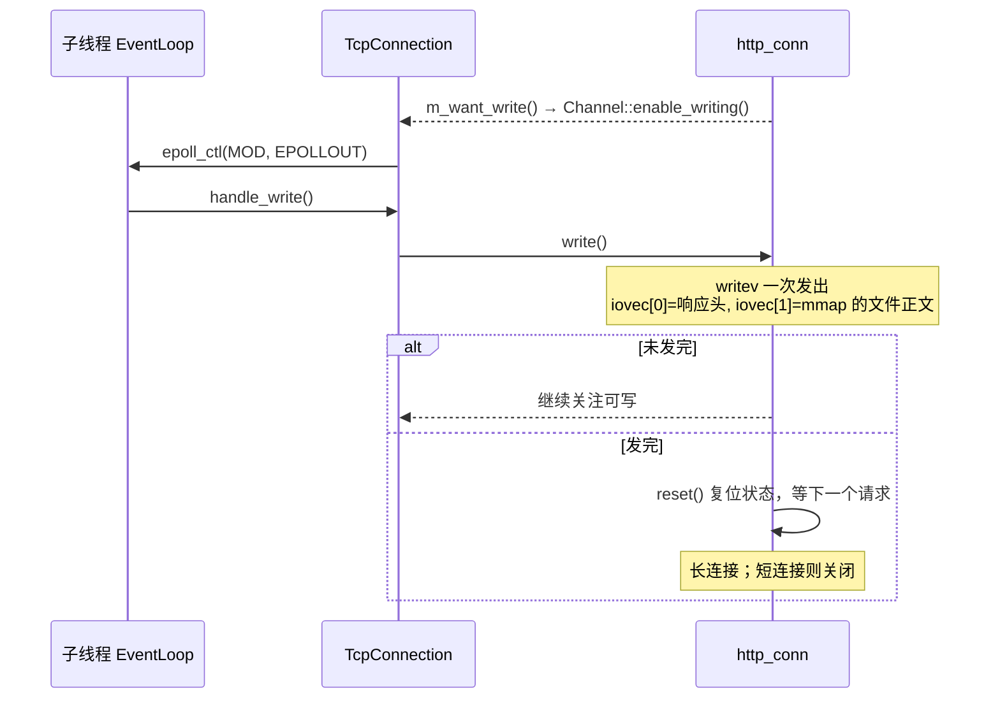

# 02 · 项目总览

> **本章讲什么**：这个项目实现了哪些功能、代码分成哪几层、启动时按什么顺序初始化、一次请求经过哪些文件。读完本章，应当能在脑中画出项目的整体地图，知道每个功能应该去哪一册深入。
>
> **对应源码**：`main.cpp`、`webserver.{h,cpp}`、`net/`、`http/`、`log/`、`CGImysql/`
> **前置知识**：如果还没读过 [01 · 看懂一个 Web 服务器](01-看懂一个Web服务器.md)，建议先读那一册。

---

## 速览

1. **功能**：静态页面与图片、用户注册登录（MySQL）、文件上传与下载、可选的请求日志。
2. **分层**：装配层（`WebServer`）→ 事件层（`net/`）→ 连接层（`TcpConnection`）→ 协议层（`http_conn`），另有日志、配置、连接池、口令哈希四个支撑模块。
3. **并发结构**：主线程只 `accept`，子 Reactor 线程各自管理一批连接；一个连接只属于一个线程。
4. **启动顺序**：屏蔽退出信号 → 解析配置 → 校验配置与站点根目录 → 初始化日志 → 初始化数据库连接池并加载用户表 → 启动线程池与事件循环。
5. **一次请求的主干**：监听 fd 可读 → `accept` → 投递给子线程 → 读字节 → 状态机解析 → 路由 → 组装响应 → `writev` 发送 → 复位等待下一个请求。

---

## 一、这个项目能做什么

### 1.1 用户能看到的功能

| 功能 | 用户操作 | 服务器行为 | 深入 |
|:--|:--|:--|:--|
| **浏览静态资源** | 打开首页、图片、视频页 | 按路径找到 `root/` 下的文件，发送给浏览器 | [03](03-静态资源服务.md) |
| **注册** | 打开 `/0`，填写用户名口令并提交 | 查重、把加盐哈希写入 MySQL、更新内存用户表 | [04](04-注册与登录.md) |
| **登录** | 打开 `/1`，填写用户名口令并提交 | 查内存用户表、校验口令哈希，跳转到欢迎页或错误页 | [04](04-注册与登录.md) |
| **上传文件** | 打开 `/8`，选择文件并提交 | 解析 `multipart/form-data`，校验类型与大小，写入 `upload/` | [05](05-文件上传与下载.md) |
| **查看上传列表** | 打开 `/upload` | 扫描 `upload/` 目录，动态生成 HTML 列表 | [05](05-文件上传与下载.md) |
| **下载上传的文件** | 点击列表中的文件 | 以附件形式返回文件内容 | [05](05-文件上传与下载.md) |
| **调试与排障** | 查看日志文件 | 记录每个请求行/响应、连接建立关闭、错误信息 | [06](06-日志系统.md) |

### 1.2 功能与路由的完整对照

`do_request()` 根据请求方法和路径决定行为。这张表把当前全部路由列全了：

| 请求 | 行为 |
|:--|:--|
| `GET /` | 返回 `judge.html`（首页） |
| `GET /0` | 返回 `register.html`（注册页） |
| `GET /1` | 返回 `log.html`（登录页） |
| `GET /5` / `/6` / `/7` | 返回 `picture.html` / `video.html` / `fans.html` |
| `GET /8` | 返回 `upload.html`（上传页） |
| `POST /2` | **登录**：校验口令哈希 → 把路径改写为 `/welcome.html` 或 `/logError.html` |
| `POST /3` | **注册**：查重后写入 → 把路径改写为 `/log.html` 或 `/registerError.html` |
| `GET /upload` | 列出已上传文件 |
| `POST /upload` | **上传**：解析 `multipart/form-data`，落盘到 `./upload/` |
| `GET /upload/<name>` | **下载**已上传文件（一律加 `Content-Disposition: attachment`） |
| 其他路径 | 按静态资源处理：解码 → 规范化 → 校验在站点根目录内 → `stat` → `mmap` |

> **登录/注册的“跳转”不是 302**：处理成功后，服务器把 `m_url` 改写成目标页面路径，然后继续走同一套静态文件发送逻辑。这是本项目的既有结构，第 [04](04-注册与登录.md) 册会解释这样做的效果与限制。

### 1.3 一页数据

| 指标 | 改造起点 | 当前 | 说明 |
|:--|--:|--:|:--|
| 默认配置 QPS | 19808 | **33151** | +67%（跨日采集） |
| P99 延迟 | 899.99 ms | **16.79 ms** | 降至约 1/54 |
| 常驻内存 | 262.8 MB | **12.6 MB** | −95%，且不再与最大连接数绑定 |
| 线程数对吞吐的影响 | 几乎无差异 | `-t1` 28372 → `-t2` **48185** | 分发真正生效 |

> 前两项跨日采集，含时段差异，仅作方向性参考；精确的同时段 A/B 见 [13 · 性能度量](13-性能度量.md)。

---

## 二、技术栈与运行环境

| 项 | 取值 |
|:--|:--|
| 语言标准 | **C++17** |
| 操作系统 | Linux（在 Ubuntu 22.04 / 内核 6.8 上开发验证） |
| 构建 | CMake ≥ 3.16（`cmake -B build` + `cmake --build build`） |
| 网络 | `epoll` + `timerfd` + `eventfd` + `signalfd` |
| 数据库 | MySQL（客户端库 `libmysqlclient`） |
| 加密 | OpenSSL（PBKDF2-HMAC-SHA256） |
| 测试 | GoogleTest + GitHub Actions + AddressSanitizer / ThreadSanitizer |
| 压测 | `wrk`（仓库内另附 `webbench 1.5` 源码，实际性能数据均以 `wrk` 采集） |

**没有用到的东西**（同样值得记）：没有 Boost/Asio 等第三方网络库（网络层全部手写），没有 JSON 库（配置是自写的 INI 解析），没有连接池以外的中间件。

---

## 三、代码分层

### 3.1 分层图



### 3.2 每层的职责边界

| 层 | 只负责 | 不负责 |
|:--|:--|:--|
| 事件层 | 「有哪些 fd 就绪了、该调用谁」 | 不知道 HTTP 是什么 |
| 连接层 | 「这个连接的生死、读写时机、超时」 | 不知道请求内容是什么 |
| 协议层 | 「这段字节流是什么请求、该回什么响应」 | **不认识 `epoll`**（只通过回调表达「想读 / 想写」） |
| 装配层 | 「把这些组件装起来、连起来」 | 不处理单个请求 |

这条边界比图更重要。比如协议层从头到尾没有调用过 `epoll_ctl`：它只说「我还想继续读」或「我准备写响应了」，由连接层把它翻译成事件注册。

### 3.3 模块地图

| 模块 | 文件 | 职责 | 详见 |
|:--|:--|:--|:--|
| 入口 | `main.cpp` | 屏蔽退出信号 → 解析配置 → 初始化 → 启动 | 本章 §四 |
| 装配 | `webserver.{h,cpp}` | 服务器主类：装配组件，处理新连接与连接关闭 | [07](07-并发模型重构.md) |
| 网络 | `net/event_loop.{h,cpp}` | 单线程事件循环：epoll、eventfd 唤醒、跨线程任务队列、连接注册表 | [07](07-并发模型重构.md) |
| 网络 | `net/channel.{h,cpp}` | fd 与关注事件的绑定，维护 `epoll_ctl` 的 ADD/MOD/DEL | [07](07-并发模型重构.md) |
| 网络 | `net/acceptor.{h,cpp}` | 监听套接字、接受新连接、描述符耗尽兜底 | [07](07-并发模型重构.md) |
| 网络 | `net/tcp_connection.{h,cpp}` | 连接生命周期、读写处理、空闲定时器 | [09](09-生命周期与资源管理.md) |
| 网络 | `net/event_loop_thread_pool.{h,cpp}` | 子 Reactor 线程池与轮转分配 | [07](07-并发模型重构.md) |
| 网络 | `net/timer_queue.{h,cpp}` | 基于 `timerfd` 的定时器队列 | [08](08-事件源统一.md) |
| 网络 | `net/signal_watcher.{h,cpp}` | 以 `signalfd` 接管退出信号 | [08](08-事件源统一.md) |
| 网络 | `net/socket_utils.{h,cpp}` | 非阻塞设置等无状态工具 | — |
| 协议 | `http/http_conn.{h,cpp}` | HTTP 状态机解析、路由、响应组装、上传处理（1600+ 行） | [10](10-协议实现.md) |
| 协议 | `http/url_codec.h` | URL 解码与路径规范化（可单测的纯函数） | [10](10-协议实现.md) |
| 日志 | `log/log.{h,cpp}` | 单例日志：批量落盘、按日期与行数轮转、同步/异步 | [06](06-日志系统.md) |
| 配置 | `config.{h,cpp}` | 三层配置来源：默认值 < 配置文件 < 命令行 | [12](12-工程基础.md) |
| 安全 | `auth/password_hash.{h,cpp}` | PBKDF2-HMAC-SHA256 | [11](11-安全加固.md) |
| 数据库 | `CGImysql/sql_connection_pool.{h,cpp}` | 连接池单例，RAII 方式借用与归还 | [04](04-注册与登录.md) |
| 并发原语 | `lock/locker.h` | 互斥量、条件变量、信号量的 RAII 包装 | [06](06-日志系统.md) |

### 3.4 运行期的线程数

```text
线程总数 = 1（主 Reactor）+ N（子 Reactor，由 -t 指定）+ 1（异步日志的写盘线程，可能没有）
```

日志写盘线程**不属于任何事件循环**：它不参与网络 IO，只按缓冲块写满或定时到点把日志成块落盘（见 [06](06-日志系统.md)）。只有**开启日志且使用异步写入**（默认 `-c 0 -l 1`）时才会创建它；同步模式（`-l 0`）或关闭日志（`-c 1`）时没有这个线程。`-t 0` 且开启异步日志时，只有主线程与写盘线程。

---

## 四、启动时发生了什么

`main.cpp` 的顺序是有讲究的，每一步都为后面的步骤准备条件：

```text
main()
 ├─ ① 屏蔽 SIGTERM / SIGINT
 │     必须在创建任何线程之前完成：信号掩码是线程属性，
 │     子线程继承创建时的掩码（见 08）
 ├─ ② 解析命令行与配置文件
 │     默认值 < config.ini < 命令行；无法识别的键或非整数取值直接终止启动
 │     取值范围在随后的 ③ / ④ 中统一校验
 ├─ ③ WebServer::init()
 │     校验端口、线程数、触发模式、站点根目录；
 │     创建监听 Acceptor 与子线程池
 ├─ ④ WebServer::log_write()
 │     创建日志目录、打开日志文件；异步模式下同时创建写盘线程
 ├─ ⑤ WebServer::sql_pool()
 │     建立 MySQL 连接池，加载用户表（必要时把明文口令迁移为哈希）
 └─ ⑥ WebServer::run()
       注册 signalfd；启动子线程；启动监听；进入主事件循环
```

几个容易忽略的点：

- **① 必须在 ④ 之前**：异步日志的写盘线程在 ④ 就创建了，晚于它再屏蔽信号会漏掉这个线程。
- **③ 的校验发生在启动期**：配置越界宁可启动失败，也不要在运行期以不确定的方式出错。
- **⑤ 中的失败处理并不相同**：连接池建立失败、口令列加宽失败、某条明文口令迁移失败都会终止启动；而用户表 `SELECT` 失败只记录错误后继续运行，此时进程内用户表为空，登录会全部失败。后一种是当前实现的已知边界，不应误解为「加载失败也会拦住启动」。

---

## 五、一次请求的完整旅程

以一次普通的静态资源请求 `GET /judge.html` 为例。

### 5.1 建立连接（主线程 → 子线程）



**关键点**：跨线程传递的只有 `connfd` 与对端地址。连接的构造、注册与启动全部在**它归属的线程**内完成——这是整个并发模型的地基。

### 5.2 读取与解析



**状态机**是协议层的核心：`parse_line()` 在缓冲区里找 `\r\n`，找到就交给当前状态的解析函数，处理完推进到下一个状态。找不到完整行就返回 `LINE_OPEN`，等下一次读事件把数据补齐——**解析状态保存在连接对象里**，因此必须随连接一同归属于某个线程。

### 5.3 发送响应



**零拷贝点**：静态文件的正文不经过应用层用户态缓冲区，而是 `mmap` 到地址空间后由 `writev` 直接从映射区读出并写入 socket 发送缓冲区。详见 [03](03-静态资源服务.md)。

### 5.4 收尾

连接关闭的五个触发点（读失败 / 处理失败 / 写失败 / 对端关闭 / 空闲超时）全部汇聚到 `TcpConnection::close()`，释放顺序为「取消定时器 → `unmap` → `EPOLL_CTL_DEL` → `close(fd)`」。详见 [09](09-生命周期与资源管理.md)。

---

## 六、数据在层间的形态

| 阶段 | 形态 | 归属 |
|:--|:--|:--|
| 跨线程投递 | `int connfd` + `sockaddr_in peer` | 主线程 → 子线程，仅此一次 |
| 读入 | `m_read_buf`（`std::vector<char>`，按需扩容，初值 2048 字节） | 协议层 |
| 解析中 | 指向读缓冲的裸指针（`m_url` / `m_host`）+ 游标（`m_checked_idx`） | 协议层；**指针不拥有内存** |
| 路由产物 | `m_real_file[200]`（根目录 + 相对路径） | 协议层 |
| 静态正文 | `mmap` 得到的映射地址 + `stat` 的文件大小 | 协议层，随连接释放而 `munmap` |
| 响应 | `m_write_buf` + `iovec[2]` | 协议层 |
| 事件意图 | `m_want_read` / `m_want_write` 两个回调 | 协议层 → 连接层的**唯一出口** |

---

## 七、术语约定

本资料与代码保持一致的叫法，避免同义替换造成歧义。

| 术语 | 含义 |
|:--|:--|
| **主 Reactor / 主循环** | 主线程的 `EventLoop`，只负责 `accept` |
| **子 Reactor / 子循环** | 子线程的 `EventLoop`，处理已建立连接的读写 |
| **连接归属** | 一个连接的 fd、协议状态、超时定时器全部只属于一个线程 |
| **事件源** | 任何能让 `epoll_wait` 返回的输入：socket、`timerfd`、`eventfd`、`signalfd` |
| **触发模式** | `-m` 的取值，监听侧与连接侧各自的 LT/ET 组合 |
| **缓冲块** | 日志异步写入的落盘单位，默认 64 KiB |
| **改造起点** | 本项目继续开发时已有的实现，不是另一个需要并列讲解的系统；只在说明某项改动时出现 |

---

## 八、跑起来

```bash
# 依赖
sudo apt install build-essential cmake libmysqlclient-dev libssl-dev libgtest-dev

# 数据库（口令以加盐哈希保存；明文插入也能用，启动时会自动升级）
mysql -e "CREATE DATABASE yourdb; USE yourdb;
          CREATE TABLE user(username char(50), passwd varchar(255)) ENGINE=InnoDB;"

# 配置（config.ini 已被 .gitignore 忽略，数据库口令写在这里而不是源码中）
cp config.example.ini config.ini && vi config.ini

# 构建与运行（**须在仓库根目录下启动**，站点/日志/上传目录都是相对路径）
sh ./build.sh && ./build/server

# 测试
ctest --test-dir build --output-on-failure
```

常用参数：

| 参数 | 含义 | 默认 |
|:--|:--|--:|
| `-p` | 监听端口 | 9006 |
| `-t` | 子 Reactor 线程数（`0` = 全归主循环，用于对照） | 8 |
| `-m` | 触发模式组合（0 = LT+LT … 3 = ET+ET） | 0 |
| `-l` | 日志写入方式（0 = 同步，1 = 异步） | 1 |
| `-s` | 数据库连接池大小 | 8 |
| `-f` | 配置文件路径 | `./config.ini` |
| `-c` | 关闭日志（0 = 打开，1 = 关闭） | 0 |

`Ctrl+C` 或 `SIGTERM` 可优雅退出，退出码为 0 且日志完整落盘。

---

## 九、怎么读这份资料

**① 第一次接触服务器项目**：从 [01](01-看懂一个Web服务器.md) 开始按顺序读，03~06 是功能实现，07 之后是架构与优化。

**② 只想理解整体架构**：本章 → [07 并发模型](07-并发模型重构.md) → [13 性能度量](13-性能度量.md)。

**③ 按需查阅**：用 [14 知识点索引](14-知识点索引.md) 从知识点反查，或用 [15 附录](15-附录.md) 的源码地图从文件反查。

**与仓库其他文档的分工**：

| 文档 | 视角 | 什么时候看 |
|:--|:--|:--|
| [README](../../README.md) | 使用者 | 想构建、配置、运行 |
| [architecture.md](../architecture.md) | 事实描述 | 想知道**现状是什么** |
| [summary.md](../summary.md) | 时间线 | 想知道**优化按什么顺序做的** |
| [performance.md](../performance.md) | 数据 | 想知道**每个数字的出处** |
| **本资料** | 学习 | 想知道**功能怎么实现、为什么这样设计、能学到什么** |

---

## 十、延伸阅读

| 想深入了解 | 去看 |
|:--|:--|
| 浏览器请求到服务器响应的基础概念 | [01 · 看懂一个 Web 服务器](01-看懂一个Web服务器.md) |
| 静态资源如何发送 | [03 · 静态资源服务](03-静态资源服务.md) |
| 注册登录如何查库 | [04 · 注册与登录](04-注册与登录.md) |
| 上传下载如何实现 | [05 · 文件上传与下载](05-文件上传与下载.md) |
| 日志如何写入 | [06 · 日志系统](06-日志系统.md) |
| 并发模型为什么这样设计 | [07 · 并发模型](07-并发模型重构.md) |
| 架构的完整事实描述 | [architecture.md](../architecture.md) |
| 全部源码位置 | [15 · 附录](15-附录.md) |

---

**下一册**：[03 · 静态资源服务](03-静态资源服务.md) —— 浏览器请求一个页面时，服务器如何找到文件、组织响应并把它高效地发送出去。
