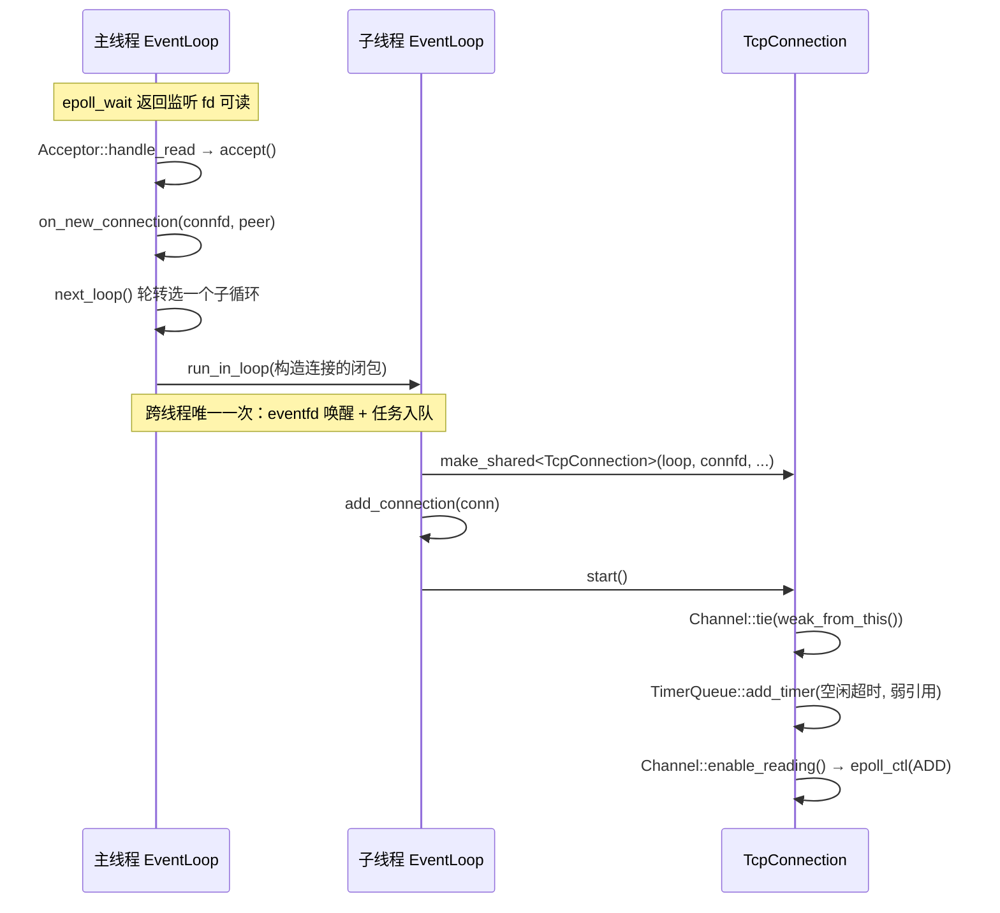
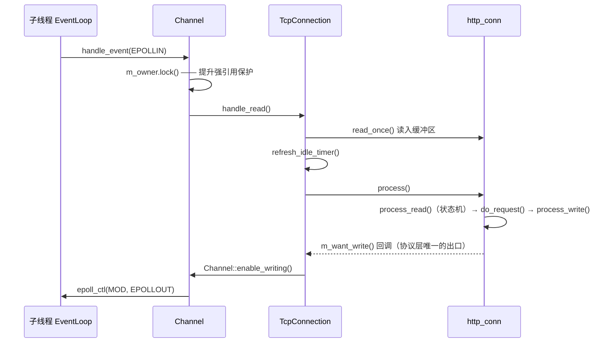
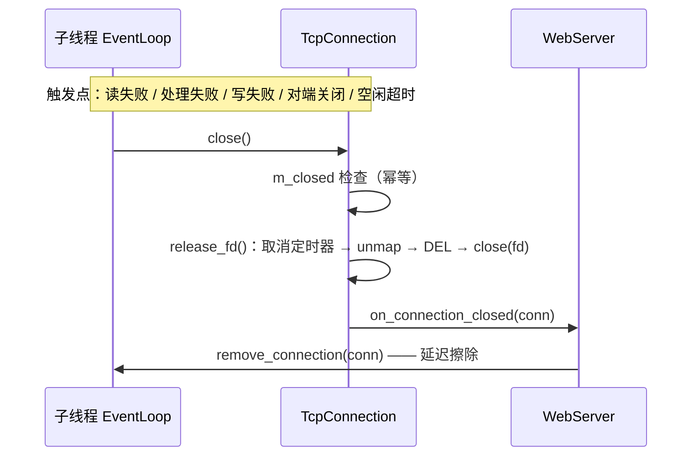

# 07 · 并发模型：让每个连接只属于一个线程

> **本章讲什么**：服务器同时面对成百上千个客户端时，最核心的决定是——**谁来处理哪个连接、在哪个线程处理**。本章先说明本项目最初的做法为什么在压力下失效，再讲现在的主从 Reactor 结构如何用「连接归属」这条约定消除竞争，最后给出性能数据与一次必现崩溃的定位过程。
>
> **读完能回答**：
>
> - 半同步/半反应堆模型是什么？它为什么会失效？
> - `EPOLLONESHOT`、忙等标志位分别在补什么洞？
> - 主从 Reactor 如何分工？「连接归属」具体指什么？
> - 跨线程投递为什么只需要发生一次？
> - 为什么改成 one loop per thread 之后就不需要给连接加锁了？
>
> **对应源码**：`net/` 全目录、`webserver.cpp`、`http/http_conn.{h,cpp}` 的事件通知部分
> **前置知识**：[01](01-看懂一个Web服务器.md) 的 epoll 与事件循环；[02](02-项目总览.md) 的分层。
> **对应记录**：`docs/changes/022`、`024`、`025`、`026`、`027`、`029`

---

## 速览

1. **并发模型解决的不是「怎么跑得更快」，而是「多个线程如何不互相踩」**。如果一条连接可能被两个线程同时读写，正确性就只能靠时序侥幸。
2. 本项目最初采用**半同步/半反应堆**：主线程 `accept`，把就绪连接投递给线程池；同一连接的读事件与写事件可能落在不同线程。于是必须用 `EPOLLONESHOT` 抑制重复投递、用主线程轮询标志位确认处理完成。
3. 这两套附加机制带来两个新问题：**CPU 空转**与**跨线程可见性无保证**。此外，连接的关闭路径分散在多处，容易重复释放同一个 fd。
4. 现在的结构是**主从 Reactor + one loop per thread**：主线程只 `accept`，连接按轮转分给子线程；一个连接的 fd、协议状态、超时定时器**全部归属同一个线程**。
5. 归属约定成立后，读写串行是结构推论，`EPOLLONESHOT` 和忙等标志位都可以删除；连接状态无共享，**不需要锁**。
6. 结果：常驻内存 60 MB → 12.6 MB；`-t 2` 下 QPS **+59%**；线程数从「对吞吐无影响」变为「显著正相关」。代价是 `-t 1` 下吞吐回退 12%~15%。
7. 本章最后完整记录一次短连接风暴下的崩溃定位：它暴露了「结构正确」之外的另一类问题——**未初始化成员**。

---

## 一、先理解问题：多个客户端同时来

### 1.1 最直观的两种做法

**做法 A：一个连接一个线程。**

```text
accept → 新建线程 → 该线程负责这条连接的一切
```

连接少时简单有效；连接一多，线程的内存与切换成本会先压垮机器（见 [01](01-看懂一个Web服务器.md) §五）。

**做法 B：线程池 + 事件分发。**

```text
主线程：epoll_wait → 发现某个连接可读 → 把「处理这个连接」投递给线程池
工作线程：从队列取任务 → 读数据 → 解析 → 组装响应
```

线程数量固定，连接数量可以很多。本项目最初采用的就是 B 的一个经典变体：**半同步/半反应堆**（half-sync/half-reactor）。

### 1.2 半同步/半反应堆的结构

```text
主线程：epoll_wait → 就绪事件 → 把连接塞进线程池任务队列
                                 │
工作线程 × N：从队列取任务 → 解析请求 → 组装响应
              ↑
   主线程轮询 improv 标志位，等它处理完才能重新注册描述符
```

「半同步」指主线程同步地等待事件，「半反应堆」指工作线程从队列中竞争任务。它在低并发下能正常工作，代码结构也不算混乱。

问题出在一条**没有写进代码的隐含假设**：

> 一条连接在某一时刻只被一个线程处理。

主线程和工作线程共享同一组连接对象；读事件、写事件、超时回收、连接关闭可能从不同线程、在不同时刻作用于同一条连接。代码里没有任何机制保证这条假设，**正确性依赖运行时的时序恰好不冲突**。

---

## 二、最初的做法在压力下暴露的三个问题

### 2.1 事件注册与生命周期分散

最初，`http_conn` 自己持有 `static int m_epollfd`（全局唯一的 epoll 实例），并在 7 处直接调用 `modfd` / `addfd` / `removefd`。结果是：

- 协议解析代码与 epoll 事件注册**深度耦合**；
- 连接的关闭动作散落在协议层、定时器回调、主循环、工作线程等多条路径；
- 无法回答「这个 fd 现在到底是活着还是已经关了」。

### 2.2 用 `EPOLLONESHOT` 抑制重复投递

因为同一连接可能被多个工作线程同时处理，注册时必须加 `EPOLLONESHOT`：

> **`EPOLLONESHOT` 是一次性关注**：某个 fd 被通知一次后，内核自动把它从关注列表里摘掉，直到程序重新注册。这样在「处理中」的窗口里，不会有第二个线程被通知到同一个 fd。

它在「连接可能跨线程」的前提下是**正确**的解法。但它只是把并发窗口缩小了，并没有消除「连接状态被多个线程访问」这个事实。

### 2.3 主线程忙等标志位

主线程把连接交给工作线程后，需要知道「处理完没有」才能重新注册。最初的实现是在 `while (true)` 里**轮询** `improv` 标志位：

- **CPU 空转**：主线程持续占一个核；
- **可见性无保证**：这个标志位是普通 `bool`，没有 `atomic`、没有内存屏障。多线程下「写线程改了、读线程马上能看到」在语言层面**没有任何保证**。

### 2.4 释放路径重叠

连接关闭与定时器回调都会释放同一个 fd，且没有幂等保护。fd 被内核回收后可能立刻分配给新连接，一条迟到的 `close` 或 `epoll_ctl(DEL)` 就会**作用到别的连接上**。

### 2.5 归结

三个问题可以归结成一句：**没有统一的「连接归属」约定**。

- 因为连接状态是多线程共享的，才需要 `EPOLLONESHOT`；
- 因为完成信号要跨线程传递，才需要轮询标志位；
- 因为释放路径分散，才容易重叠。

**要根治，必须换模型，而不是继续加锁或加标志位。**

> 项目启动时整理过一份 28 项的问题清单，其中并发与生命周期类 7 项、正确性与健壮性 11 项、协议 3 项、功能 2 项、规范 5 项。完整分类见 [15 · 附录](15-附录.md)。本章只展开与并发模型直接相关的部分。

---

## 三、目标：一条连接只属于一个线程

### 3.1 目标模型

```text
                    ┌───────────────────────────┐
   监听套接字 ──────▶│  主线程 EventLoop          │
                    │  · Acceptor（监听）        │
                    │  · SignalWatcher（退出信号）│
                    └───────────┬───────────────┘
                                │ run_in_loop（按轮转投递）
              ┌─────────────────┼─────────────────┐
              ▼                 ▼                 ▼
     ┌────────────────┐ ┌────────────────┐ ┌────────────────┐
     │ 子线程 EventLoop│ │ 子线程 EventLoop│ │ 子线程 EventLoop│
     │ · epoll        │ │ · epoll        │ │ · epoll        │
     │ · TimerQueue   │ │ · TimerQueue   │ │ · TimerQueue   │
     │ · TcpConnection│ │ · TcpConnection│ │ · TcpConnection│
     └────────────────┘ └────────────────┘ └────────────────┘
```

- **主线程**只负责接受新连接，不处理请求；
- **子线程**各自持有一个 `epoll` 实例与事件循环，处理一批已建立的连接；
- `-t 0` 是合法的退化配置：不建子线程，全部连接归主循环，用来做单线程对照实验。

### 3.2 核心约束

> **一个连接的文件描述符、协议解析状态与其超时定时器，全部归属同一个线程。**

这条约束成立之后：

| 原来的问题 | 现在的状态 |
|:--|:--|
| 同一连接可能被两个线程读写 | 读写串行成为结构推论，不需要 `EPOLLONESHOT` |
| 连接状态需要跨线程同步 | 状态只在一个线程内访问，**不需要锁** |
| 主线程要等 worker 处理完 | 连接就在本线程处理，不需要标志位与轮询 |
| 定时器可能跨线程修改链表 | 每个事件循环有自己的 `TimerQueue`，竞争在结构上不存在 |

这与「加锁保护共享数据」是两种思路：加锁是**事后补救**，归属约定是**事前消除**。后者更快，也更不容易出错。

### 3.3 明确不引入的抽象

成熟网络库（如 muduo）会提供 `Buffer`、`Poller`、`TcpServer` 等一整套抽象，本项目**有意不引入**其中若干项：

| 不引入 | 理由 |
|:--|:--|
| 通用 `Buffer` 类 | 协议对象已持有缓冲区，且状态机游标与之强耦合 |
| `Poller` 抽象基类 | 只有 epoll 一种实现，无需虚函数层 |
| 独立 `TcpServer` 类 | 只有一个监听端口，职责由 `WebServer` 直接承担 |
| 地址与套接字的 RAII 包装 | 仅一种使用场景，无状态自由函数即可 |

抽象的收益是「支持多种实现」，成本是「多一层间接、多一份要理解的代码」。**「能抽象」不等于「该抽象」**。

---

## 四、实现：三个核心类

### 4.1 `EventLoop`：一个线程的事件循环

`EventLoop` 持有一个 `epoll` 实例、一个 `eventfd`（跨线程唤醒）、一个待执行任务队列：

```cpp
void loop();                            // 循环主体，必须在创建它的线程调用
void quit();                            // 线程安全：置位；从其他线程调用时用 eventfd 叫醒循环
void run_in_loop(Functor cb);           // 本线程立即执行，否则入队并唤醒
void update_channel(Channel *channel);  // 依据 Channel 状态决定 ADD 还是 MOD
```

`run_in_loop` 是**跨线程协作的统一入口**，语义是「确保这段代码在 loop 线程内执行」；`queue_in_loop` 是它的「只入队、不立即执行」版本。

#### 三个实现细节

1. **`loop()` 不重置退出标志**：循环启动前调用 `quit()` 是合法的，重置会把那次请求丢掉。
2. **任务先在锁内整块换出、再在锁外执行**：任务本身可能再次 `queue_in_loop`，持锁执行会**自锁**。
3. **`epoll_wait` 用无限超时**（`-1`）：有了 `TimerQueue` 之后依然正确，定时器到点会通过 `timerfd` 主动唤醒循环（见 [08](08-事件源统一.md)）。

#### `eventfd` 是什么

`eventfd` 是 Linux 提供的一个特殊 fd，内部是一个 8 字节计数器：

- 某线程往它写入一个数，计数器增加；
- 它的 fd 变成「可读」，正在 `epoll_wait` 的循环被唤醒；
- 读一次就把计数器清零。

用它做跨线程唤醒，比自建管道简单：**一个 fd、固定 8 字节、不需要区分读写端**。

### 4.2 `Channel`：fd 与事件的绑定

`Channel` 记录「这个 fd 关心什么事件、就绪后调用谁」：

```cpp
void enable_reading();
void enable_writing();
void disable_all();
void remove();          // EPOLL_CTL_DEL
void handle_event(uint32_t revents);
```

两个设计要点：

- **只标识描述符，不拥有它**。关闭时机由所有者决定，`Channel` 只保证「关闭之前先把自己从事件表摘掉」。**`EPOLL_CTL_DEL` 必须先于 `close(fd)`**——描述符被内核复用后，迟到的 `DEL` 会作用到新连接上。
- **热路径上消除系统调用**：协议层在「请求没收全」时每个事件都要求关注可读，若无条件发 `EPOLL_CTL_MOD` 就会多出与请求数等量的系统调用，因此**先比较再更新**：

```cpp
void Channel::enable_reading()
{
    if (kReadEvent == m_events) return;   // 已是该状态，不发系统调用
    m_events = kReadEvent;
    update();
}
```

`handle_event` 的分派顺序是**读 → 写 → 关闭**。原因：`EPOLLRDHUP` 只表示对端关闭**写端**，接收缓冲区里可能还留着最后一个请求（通常与 `EPOLLIN` 一起返回），先走关闭会丢掉它。

### 4.3 `TcpConnection`：一条连接的完整生命周期

`TcpConnection` 持有：

```cpp
EventLoop *m_loop;
int m_fd;                              // 本对象是它的唯一所有者
std::unique_ptr<Channel> m_channel;
http_conn m_conn;                      // 协议对象，按值持有
uint64_t m_timer_id;                   // 0 表示没有登记
bool m_closed;
```

它的职责是连接层的：读写时机、空闲超时、关闭与释放。请求内容是什么，它不知道。

---

## 五、跨线程只发生一次

### 5.1 建立连接

```cpp
EventLoop *loop = m_thread_pool->next_loop();
loop->run_in_loop([this, loop, connfd, peer] {
    const std::shared_ptr<TcpConnection> conn = std::make_shared<TcpConnection>(
        loop, connfd, peer, m_root, m_conn_trig_mode, m_close_log, m_connPool, IDLE_TIMEOUT_MS);
    conn->set_close_callback(...);
    loop->add_connection(conn);   // 顺序固定：先登记
    conn->start();                // 再启动
});
```

`on_new_connection` 运行在主线程，而连接的**构造**必须发生在它归属的循环线程内，否则协议对象与 `Channel` 就跨越了两个线程。

注意 `add_connection` 在 `start()` 之前：`start()` 注册的空闲定时器持有连接的**弱引用**，要求它此前已被 `shared_ptr` 持有。

**跨线程传递的，只有描述符与对端地址这一次。** 此后：
- 读事件、写事件、关闭事件都在子线程处理；
- 协议状态只在子线程修改；
- 超时定时器只属于子线程的 `TimerQueue`。

### 5.2 线程池与轮转

`EventLoopThreadPool` 负责创建子循环并分配连接：

```cpp
EventLoop *EventLoopThreadPool::next_loop()
{
    if (m_thread_num <= 0) return m_base_loop;
    const int index = m_next.fetch_add(1) % m_thread_num;
    if (m_loops[index] == nullptr) return m_base_loop;
    return m_loops[index];
}
```

`std::atomic<int>` 自增取模，无锁轮转。`start()` 用条件变量等到所有子线程都把自己的 `EventLoop` 指针填进 `m_loops` 才返回；此后这些指针在运行期只读，**不再需要同步**。

一个容易忽略的细节：`EventLoop` 建在子线程自己的栈上：

```cpp
void EventLoopThreadPool::thread_func(int index)
{
    EventLoop loop;      // 栈上，析构发生在本线程内
    ...
    loop.loop();
}
```

`EventLoop` 的析构会清空连接注册表，而注册表可能持有连接的**最后一份引用**。建在子线程栈上，连接的最终释放也发生在这个线程——**释放资源的人与使用资源的人是同一个**。

---

## 六、生命周期保护：`tie` 与延迟擦除

这是 C++ 网络编程最容易踩的两处悬垂引用。

### 6.1 回调执行到一半，对象被释放了

关闭连接的回调从 `handle_event` 内部触发，而「关闭」往往意味着持有者的**最后一个 `shared_ptr` 被释放**。如果回调返回后继续访问连接对象，就是 use-after-free。

解法是在**分派点**统一加保护，而不是要求每个回调都记得先 `shared_from_this()`：

```cpp
// net/channel.cpp  handle_event()
std::shared_ptr<void> guard;
if (m_tied) {
    guard = m_owner.lock();
    if (!guard) return;      // 持有者已销毁，此事件不再有意义
}
```

`Channel` 持有持有者的**弱引用**（`weak_ptr`），事件分派前尝试提升为强引用。类型取 `void` 是为了不依赖持有者的具体类型。

### 6.2 从注册表擦除，擦掉了最后一份引用

连接的关闭由它**自己的回调**触发。若在回调栈内直接 `erase`，注册表持有的那份（可能也是最后一份）引用会在回调返回之前析构对象——而调用栈上还站着这个对象的方法。

解法是**延迟擦除**：

```cpp
void EventLoop::remove_connection(const std::shared_ptr<void> &conn)
{
    queue_in_loop([this, conn] { m_connections.erase(conn); });   // 按值捕获，下一轮再擦
}
```

把「析构当前调用栈上的对象」推迟到下一轮循环，回调就能安全返回。

---

## 七、连接关闭：统一入口 + 幂等

五个触发点——**读失败、处理失败、写失败、对端关闭、空闲超时**——全部汇聚到 `TcpConnection::close()`：

```cpp
void TcpConnection::close()
{
    if (m_closed) return;    // 多个触发点可能同轮到达
    m_closed = true;
    release_fd();
    if (m_close_callback) m_close_callback(shared_from_this());
}
```

实际释放拆到 `release_fd()`，因为**析构函数里不能调用 `shared_from_this()`**（对象已在销毁中）。释放顺序固定：

```text
取消定时器 → unmap() → disable_all → Channel::remove() → ::close(fd)
```

`unmap()` 排前面，因为文件映射可能建立在一个**尚未写出响应**的请求上，那条路径不经过 `write()`。

完整分析见 [09](09-生命周期与资源管理.md)。

---

## 八、协议层解耦：只表达「关心什么」

最初的 `http_conn` 自己调 `epoll_ctl`（7 处 `modfd`），与 `Channel` 重复注册、无法共存。改造办法是**注入两个回调**：

```cpp
// http/http_conn.h
using EventCallback = std::function<void()>;
void set_event_notifier(EventCallback want_read, EventCallback want_write);
```

`modfd(EPOLLIN)` 变成 `m_want_read()`，`modfd(EPOLLOUT)` 变成 `m_want_write()`，**协议层从此完全不认识 epoll 与 `Channel`**。

这个拆分之所以自然，是因为「请求没收全就继续读」「响应就绪就转去写」本来就是**解析逻辑的一部分**；而「怎么把意图变成 `epoll_ctl`」才是事件层的事。改动本身很小（注入回调 + 替换 5 处调用点，协议代码的其余部分没动）——**耦合的代价不在于改起来难，而在于它把两件不同的事绑死在了一起**。

---

## 九、一次请求在层间如何流动

| 层 | 模块 | 输入 | 输出 |
|:--|:--|:--|:--|
| 装配层 | `WebServer` / `Acceptor` / `EventLoopThreadPool` | 新连接 | 把连接归属到某个循环 |
| 事件层 | `EventLoop` / `Channel` | 内核就绪事件 | 回调调用 |
| 连接层 | `TcpConnection` | 读 / 写 / 关闭事件 | 驱动协议层；管理定时器与释放 |
| 协议层 | `http_conn` | 字节流 | 响应字节流 **+ 事件意图**（想读还是想写） |

### 9.1 连接建立



### 9.2 读请求 → 组装响应



写路径对称：`handle_write()` → `http_conn::write()`（`writev` 发送）→ 未发完继续关注可写，发完则复位状态等下一个请求。

### 9.3 关闭



---

## 十、关键接口与字段

### 10.1 关键接口

| 接口 | 位置 | 语义 | 为什么这样设计 |
|:--|:--|:--|:--|
| `run_in_loop(cb)` | `EventLoop` | 确保 `cb` 在 loop 线程内执行 | 跨线程协作的统一入口 |
| `queue_in_loop(cb)` | `EventLoop` | 只入队，不立即执行 | 供「不能在当前栈内做」的场景（如延迟擦除） |
| `tie(weak_ptr)` | `Channel` | 绑定持有者弱引用 | 在分派点统一做生命周期保护 |
| `set_event_notifier(r, w)` | `http_conn` | 注入「想读 / 想写」回调 | 让协议层不依赖 epoll |
| `close()` | `TcpConnection` | 关闭的统一入口 | 幂等，五个触发点共用；实际释放由 `release_fd()` 完成 |
| `next_loop()` | `EventLoopThreadPool` | 轮转取一个子循环 | `std::atomic<int>` 自增取模，无锁 |

### 10.2 关键字段

| 字段 | 所在类 | 作用 | 设计要点 |
|:--|:--|:--|:--|
| `m_thread_id` | `EventLoop` | 标识循环所属线程 | `is_in_loop_thread()` 的依据 |
| `m_wakeupfd` | `EventLoop` | `eventfd`，跨线程唤醒 | 单 fd + 8 字节计数 |
| `m_pending_functors` + `m_mutex` | `EventLoop` | 跨线程待执行任务 | 换出到锁外执行，避免自锁 |
| `m_connections` | `EventLoop` | 连接注册表 | 元素类型 `shared_ptr<void>`；只在循环线程内访问，无需加锁 |
| `m_in_epoll` | `Channel` | 是否已在事件表中 | 决定 `epoll_ctl` 走 `ADD` 还是 `MOD` |
| `m_owner` / `m_tied` | `Channel` | 持有者弱引用 | `handle_event` 期间提升；失败则丢弃事件 |
| `m_trig_mode` | `Channel` | 触发模式 | 监听侧与连接侧可不同 |
| `m_closed` | `TcpConnection` | 幂等标志 | 多个关闭触发点可能同轮到达 |
| `m_timer_id` | `TcpConnection` | 空闲定时器句柄 | 不用 fd 下标——fd 复用后会命中另一条连接 |
| `m_want_read` / `m_want_write` | `http_conn` | 事件意图出口 | 缺省为空操作 |
| `m_conn_count` | `WebServer` | 活跃连接数 | `std::atomic<long>` |
| `m_idle_fd` | `Acceptor` | 预留的空闲描述符 | `EMFILE` 兜底的抓手 |

---

## 十一、结果

### 11.1 结构性证据

持续施压下采样各线程 CPU（两次读 `/proc/<pid>/task/*/stat` 取差）：

| 线程 | `-t 4` | `-t 0`（对照） |
|:--|--:|--:|
| 子线程 | 49.7% / 49.7% / 49.7% / 49.0% | — |
| 主线程（只 accept） | **0.0%** | **99.0%**（单核饱和） |

四个子线程负载几乎相同、主线程不再承担数据处理——**轮转分发是真实发生的**，而不是「参数改了但没生效」。这类结构性证据比 QPS 数字更能说明问题。

### 11.2 性能数据

**重构前后的同时段 A/B（`031`）**（把重构前的代码用 `git worktree` 重建，与当前代码同一时段背靠背测量，方法见 [13](13-性能度量.md)；最终 HEAD 上的复核见 `034`）：

| 配置 | 旧 QPS | 新 QPS | 变化 | 旧 RSS | 新 RSS |
|:--|--:|--:|--:|--:|--:|
| `-m 0 -t 8` | 29084 | **33426** | +15% | 60.0 MB | **12.6 MB** |
| `-m 0 -t 1` | 32246 | 27290 | **−15%** | 60.0 MB | 11.7 MB |
| `-m 0 -t 2` | 29663 | **47177** | **+59%** | 60.0 MB | 11.8 MB |
| `-m 0 -t 4` | 27901 | 32838 | +18% | 60.0 MB | 12.1 MB |

最值得注意的是 `-t 2`：**+59%**，且是在把 `-t` 从 8 降到 2 的同时取得的。旧架构下 `-m 0 -a 0` 的 `-t 1/2/4/8` QPS 分别为 19577 / 19745 / 19566 / 19808（**参数几乎无影响**），新架构下 `-t 2` 相对 `-t 1` 提升七成以上。**从「无影响」到「显著正相关」，才是重构生效的标志。**

### 11.3 代价与取舍

| 项 | 表现 | 解释 |
|:--|:--|:--|
| **`-t 1` 回退** | 两次独立测量均回退（−15% / −12.4%） | 新架构为**每个连接**维护独立的定时器与事件源，单线程开销高于旧的半同步模型 |
| **`-t 8` 的 P99 略高** | 9.57 ms → 16.79 ms | 旧架构 `-t 8` 时 `-t` **实际未生效**，其 P99 不可与新架构同名配置类比。**此项尚无定论** |
| **4 vCPU 限制** | `-t 2` 即封顶 | 测试机是 2 物理核 + 超线程，`wrk` 与服务端同机竞争。换硬件后最优线程数会变 |

> **「`-t 2` 最优」是有强烈环境成分的结论**，不能当普适规律搬走。

---

## 十二、崩溃定位：一次完整的工程排查

阶段三期间发现并修复了一个**必现的崩溃**。它在新架构上被暴露（旧架构触发概率极低），定位过程本身是很好的教材。

### 12.1 现象

短连接施压（`wrk -c100 -H "Connection: close"`，4 秒内建立/关闭约 8 万条）：

| `-t` | 崩溃轮数 |
|--:|--:|
| 0 | 0/5 |
| 1 | **4/5** |
| 2 | **5/5** |
| 4 | 2/5 |

`-t 1` 就有 4/5 的崩溃率 → 问题位于**主线程与子线程的那条路径**上，不需要子线程间竞争。加大压力后 `-t 0` 也崩 → **不是多线程竞态，是确定性逻辑缺陷**，只是单线程下概率低。

崩溃点各不相同（`_int_malloc`、`epoll_ctl`、跳转到 `0x0`），是典型的**堆破坏**：破坏点与崩溃点分离。崩溃轮次 QPS 会先退化（6500 → 3672），说明破坏在**累积**。

### 12.2 一条重要的排除线：ASan 为什么没抓到

先试 AddressSanitizer（ASan，检查越界访问与释放后使用），**14 轮以上零报告**。但 Release 下 2.6 万个请求就崩，而 ASan 下同等时间跑了约 6.5 万个请求——**不是概率不足**。

结论：**这一类破坏不在 ASan 的检查范围内**。本例 `munmap` 的地址与长度都**合法**，只是**不属于自己**——这是语义错误，不是访问错误。

> **教训**：「ASan 干净」不能作为「没有内存问题」的证据。

### 12.3 根因

当时 `http_conn` 的构造函数**只初始化了两个事件通知器，其余成员全部未初始化**；而 `reset()` 的**第一步**就是 `unmap()`，它读 `m_file_address` 判断有没有待释放的映射——**读的是未初始化值**。

连接对象复用堆内存（`make_shared` 拿到的内存块残留上一个连接的取值，`malloc` 不清零），于是：

1. 连接 A 处理文件请求，`mmap` 得到地址 P，写入 `m_file_address`；
2. 连接 A 关闭，`unmap()` 释放 P，对象析构，内存归还堆；
3. 连接 B 复用同一块内存，`m_file_address` **残留着 P**；
4. 连接 B 构造 → `reset()` → `unmap()` 读到 P → `munmap(P, 残留的 st_size)`。

**这一步 `munmap` 解除的不是自己的映射**，那块地址可能已被重新用于堆扩展或 malloc arena。堆被无声破坏，直到很久以后某次 `malloc` 才暴露。这也解释了为什么**只有文件请求**是必要条件——只有走 `do_request` 的请求才会 `mmap`。

valgrind（memcheck，专门检查未初始化值的使用）一击命中：

```text
Conditional jump or move depends on uninitialised value(s)
   at unmap (http_conn.cpp:1193)
   by http_conn::reset() (http_conn.cpp:524)
```

> **教训二**：此前的困境不是分析不够，而是**工具不对**。翻查 45 轮不如换一个对的工具。

### 12.4 修复与验证

在构造函数里初始化相关成员（`m_file_address = nullptr`、`m_file_stat = {}` 等）即可。

| 项 | 修复前 | 修复后 |
|:--|:--|:--|
| 短连接 `-t 1` | 4/5 崩溃 | **0/10** |
| 短连接 `-t 0/2/4` | 0/5、5/5、2/5 | **0/15** |
| valgrind | 11 errors | **0 errors** |
| `SIGTERM` 退出码 | — | **0**（自行退出，非被信号杀死） |

性能**不降反升**（`-t 2` 45918 → 50530）：提升本身就是旁证——此前破坏持续累积、拖慢 `malloc`，现在这条损耗消失了。

### 12.5 TSan 又查出两处竞争

TSan（ThreadSanitizer，检查数据竞争）在修复后继续检查，又发现：

| 竞争 | 根因 | 修法 |
|:--|:--|:--|
| `localtime` 写全局静态缓冲区 | `localtime` **不是线程安全的**，首次调用还触发 `tzset` 改写全局时区状态 | 改用 `localtime_r`，并在单线程的 `Log::init()` 里先 `tzset()` 预热 |
| `m_fp` 判空在锁外 | 日志轮转时 `m_fp` 一度成为悬垂指针，另一线程在锁外读它判空 | 把判空移入锁内 |
| `m_root` 释放早于子线程退出 | `free(m_root)` 在析构**函数体**里，而 `m_thread_pool` 要等函数体之后才析构（由它 join 子线程） | 函数体开头先 `m_thread_pool.reset()` |

第三处正好呼应 §5.2 的析构顺序——`m_root` 至今仍是 `strdup`/`free` 而非 RAII 成员，原因就在这个**析构顺序约束**上（见 [09](09-生命周期与资源管理.md)）。

---

## 十三、通用知识

**并发模型**

- **Reactor / Proactor 的区别**；Linux `epoll` 是**就绪**通知，不是完成通知
- **one loop per thread**：主从 Reactor 的分工，以及「每线程一个循环」背后更重要的**对象归属约定**
- **LT 与 ET 的语义差别**；ET 下必须读到 `EAGAIN` 的原因
- **`EPOLLONESHOT` 的用途**：服务于「一个连接可能被多个线程处理」的前提；归属约定成立后它就不再必要
- **「结构保证」优于「机制保证」**：用归属约定消除共享，比用锁保护共享更彻底

**epoll 与网络编程**

- **`epoll_create1` / `epoll_ctl` / `epoll_wait`**；`ADD` 与 `MOD` 的语义区分
- **`EPOLL_CTL_DEL` 必须先于 `close(fd)`**——描述符复用是这类 bug 的根源
- **`EPOLLRDHUP` 的半关闭语义**，以及为什么关闭分派要放在读之后
- **非阻塞 `accept` 的正确循环**：LT 取一个、ET 读到 `EAGAIN`，并处理 `EINTR` / `ECONNABORTED`
- **EMFILE 兜底**：ET 下 `accept` 因描述符耗尽失败后不再触发，服务会**永久失去接受能力**；预留一个空闲描述符（本项目用 `/dev/null`）+ accept 后立即关闭是标准解法

**C++ 语言与对象模型**

- **`shared_ptr` / `weak_ptr`**：`lock()` 提升为强引用，用于「回调期间保证对象存活」与「对象已死则安静丢弃」
- **`shared_from_this()` 不能在析构函数里调用**，故释放逻辑拆到独立函数
- **`std::function` 与回调注入**：把「意图」与「实现」解耦
- **`std::atomic<int>` 的轮转计数**；普通 `bool` 做跨线程标志位不安全的原因
- **线程归属**：线程只应在自己栈上构建属于自己的对象
- **未初始化成员**：对象复用堆内存时会读到上一次的残留值，必须在构造函数里显式初始化

**工程方法**

- **优化必须给出代价**，且代价要能解释成因
- **结构性证据优先于性能数字**：线程 CPU 分布比 QPS 更能证明「分发生效了」
- **工具的能力边界**：ASan 查访问错误、valgrind 查未初始化值、TSan 查数据竞争——知道每种工具**查不了什么**，和知道它能查什么同样重要
- **复现先于结论**：未经复现的线索只能记作「未验证」

---

## 十四、延伸阅读

| 想深入了解 | 去看 |
|:--|:--|
| `EventLoop` / `Channel` 的设计与单测 | [changes/022](../changes/022-event-loop-and-channel.md) |
| 主循环切换与协议层解耦 | [changes/024](../changes/024-single-loop-reactor.md) |
| 线程池与轮转分发的落地 | [changes/026](../changes/026-sub-reactor-thread-pool.md) |
| 崩溃的现象与定位过程 | [changes/027](../changes/027-short-connection-crash.md) |
| 崩溃根因、修复与 TSan 验证 | [changes/029](../changes/029-uninit-mapping-crash.md) |
| 定时器、跨线程唤醒、退出信号 | [08 · 事件源统一](08-事件源统一.md) |
| 连接与内存的完整生命周期 | [09 · 生命周期与资源管理](09-生命周期与资源管理.md) |
| 性能数据的采集与解读方法 | [13 · 性能度量](13-性能度量.md) |
| 改造起点的问题清单 | [15 · 附录](15-附录.md) |

---

**下一册**：[08 · 事件源统一](08-事件源统一.md) —— 定时器、跨线程唤醒、进程退出信号如何全部变成文件描述符，以及为什么「全项目没有自定义信号处理函数」是一件好事。
