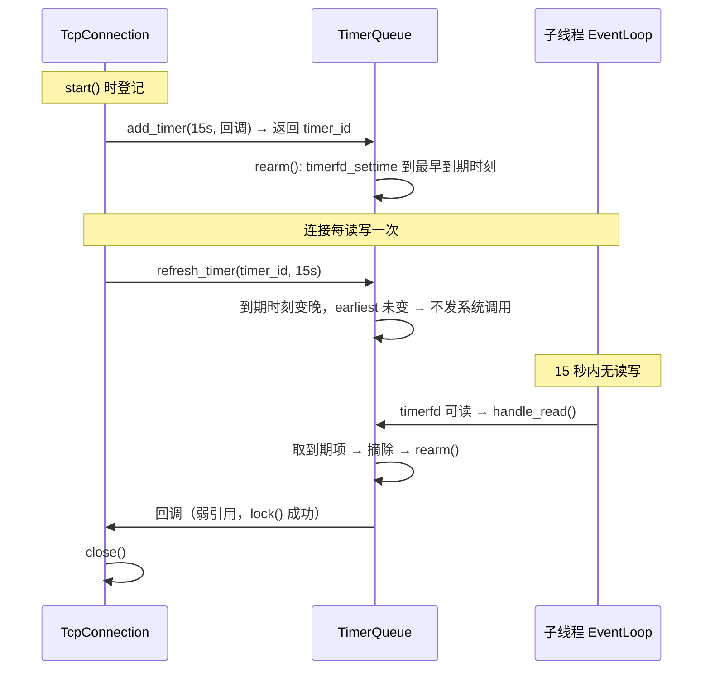

# 08 · 事件源统一：定时器、唤醒与退出信号

> **本章讲什么**：服务器要等待的外部输入不止网络数据，还有「时间到了」「别的线程叫我」「进程该退出了」。本章先解释这三种需求分别是什么、最初如何实现，再讲本项目为什么把它们全部变成**文件描述符**，从而让一个 `epoll` 统一照看，并做到**全项目没有自定义信号处理函数**。
>
> **读完能回答**：
>
> - `timerfd`、`eventfd`、`signalfd` 分别是什么？各自解决什么问题？
> - 信号处理函数为什么危险？「异步信号安全」是什么意思？
> - 为什么屏蔽信号必须在创建任何线程之前完成？
> - 定时器精度从 18.6 秒改善到 15.0 秒，原因是什么？
>
> **对应源码**：`net/timer_queue.{h,cpp}`、`net/signal_watcher.{h,cpp}`、`net/event_loop.cpp` 的 eventfd 部分
> **前置知识**：[01](01-看懂一个Web服务器.md) 的 fd 与 epoll；[07](07-并发模型重构.md) 的事件循环。
> **对应记录**：`docs/changes/023`

---

## 速览

1. 一个服务器要等四类事件：**网络可读/可写**、**定时到点**、**跨线程唤醒**、**进程退出信号**。
2. 网络事件本来就走 `epoll`；另外三类最初绕开了它：定时用 `alarm()` + `SIGALRM` + 信号处理函数，退出用 `SIGTERM`，都靠往 `socketpair` 写字节再让 `epoll` 发现。
3. 绕开的代价是**信号处理函数**：它运行在异步上下文里，只能调用极少数「异步信号安全」的函数，逻辑被迫拆成两半；定时精度也被绑死在 `alarm` 的秒级粒度上。
4. 换成 `timerfd`、`eventfd`、`signalfd` 后，这三类事件都变成**普通的可读 fd**，处理逻辑回到正常的事件循环里。
5. **一条必须遵守的时序**：信号屏蔽必须早于任何线程创建。信号掩码是线程属性，子线程继承创建时的掩码。
6. 效果：空闲连接回收时刻从配置 15 秒、实测 **18.6 秒**，变为实测 **15.0 秒**；四类事件走同一套 `Channel::handle_event`。
7. 定时器每个事件循环一份，因此天然归所属线程所有——定时器与连接之间的并发访问**在结构上不存在**。

---

## 一、先分清四类「等待」

事件循环的核心是 `epoll_wait`：没有事件时它阻塞，有事件时返回就绪列表。但服务器需要等待的东西不止网络数据：

| 需求 | 例子 | 最初的做法 |
|:--|:--|:--|
| **网络可读/可写** | 客户端发来请求、发送缓冲区有空位 | 本来就走 `epoll` |
| **定时到点** | 连接空闲 15 秒要回收 | `alarm(5)` + `SIGALRM` + 信号处理函数 + `socketpair` |
| **跨线程唤醒** | 主线程让子线程执行一段代码 | 自建管道 / `socketpair` |
| **进程退出** | 收到 `SIGTERM` / `SIGINT` | 同一个信号处理函数 + 同一条管道，靠字节值区分 |

为什么后三类不能也交给 `epoll`？因为它们本身不是 fd。`epoll` 只能盯着 fd 看，于是最初的实现只能借助「信号」和「管道」把它们间接接进事件循环。

---

## 二、信号处理函数为什么是个问题

### 2.1 什么是信号

信号是操作系统发给进程的一种异步通知。比如：

- 用户在终端按 `Ctrl+C`，进程收到 `SIGINT`；
- 系统关机或 `kill` 命令，进程收到 `SIGTERM`；
- 定时器到点，进程收到 `SIGALRM`；
- 向已关闭的连接写数据，进程收到 `SIGPIPE`。

进程可以给信号注册一个**信号处理函数**：信号到达时，内核中断进程当前的执行流，跳去执行这个函数，执行完再回来。

### 2.2 危险在哪里

关键在「中断当前执行流」这几个字：信号处理函数可能在主流程执行到**任意一条指令**时插进来。如果它调用了 `malloc`，而主流程正好也在 `malloc` 内部、持有堆锁，就会死锁或破坏堆。

因此信号处理函数只能调用**异步信号安全**（async-signal-safe）的函数。这份白名单很短：

- `printf`、`malloc`、`std::string` 的操作**都不在其中**；
- 安全的基本上只有 `write`、`read`、`_exit` 等少数系统调用。

最初的实现里，那个信号处理函数能做的事只有「往管道写一个字节」——**这正是这种限制的直接体现**：不是不想多做事，而是不能。

### 2.3 由此派生的三个后果

1. **逻辑被迫拆成两半**：信号处理函数只负责「记录发生了这件事」，真正的处理要回到事件循环里做。
2. **精度受限于信号粒度**：`alarm` 以秒为单位，`TIMESLOT` 是 5 秒 → 定时器实际是「每 5 秒全表扫描一次」，而不是「到点触发」。配置 15 秒的超时，实测 18.6 秒才回收。
3. **一个处理函数服务两类事件**，靠管道里的字节值区分——耦合且难以扩展。

---

## 三、三个「把事件变成 fd」的工具

### 3.1 `timerfd`：内核里的闹钟

`timerfd` 是 Linux 提供的一种 fd。创建时告诉内核「我要一个定时器」：

```cpp
int tfd = timerfd_create(CLOCK_MONOTONIC, TFD_NONBLOCK | TFD_CLOEXEC);
```

设置到期时间：

```cpp
struct itimerspec spec = {};
spec.it_value.tv_sec  = 15;      // 15 秒后到期
timerfd_settime(tfd, 0, &spec, nullptr);
```

到期后，这个 fd 变成**可读**；`read` 它会得到一个 8 字节的 `uint64_t`，表示「到期了几次」。于是定时事件和网络事件一样，都是 `epoll_wait` 返回的一个可读 fd。

**为什么用 `CLOCK_MONOTONIC`**：单调时钟只向前走，不受系统时间调整（如 NTP 校正）影响。用墙上时钟做超时判定，一次时间回拨可能让连接被误回收或永远不超时。

### 3.2 `eventfd`：跨线程的门铃

`eventfd` 内部是一个 8 字节计数器：

```cpp
int efd = eventfd(0, EFD_NONBLOCK | EFD_CLOEXEC);
```

- 线程 A 往它写一个数 → 计数器增加，fd 变可读；
- 线程 B 正在 `epoll_wait` → 被唤醒；
- 读一次 → 计数器清零，继续等待。

它比自建管道简单：**一个 fd、固定 8 字节、不需要区分读写端**。本项目用它实现 `EventLoop::quit()` 和 `run_in_loop()` 的跨线程唤醒。

### 3.3 `signalfd`：把信号变成一封信

`signalfd` 把「信号」变成「可以从 fd 读出来的结构体」：

```cpp
sigset_t mask;
sigemptyset(&mask);
sigaddset(&mask, SIGTERM);
sigaddset(&mask, SIGINT);

int sfd = signalfd(-1, &mask, SFD_NONBLOCK | SFD_CLOEXEC);
```

前提是**这些信号已经被屏蔽**（不会按默认动作终止进程）。屏蔽之后，信号不会打断执行流，而是排队等待；`signalfd` 的 fd 变成可读，`read` 得到 `struct signalfd_siginfo`，里面记录是哪个信号。

读的时候有一个硬性要求：**缓冲区长度必须是 `sizeof(struct signalfd_siginfo)`**，否则 `read` 返回 `EINVAL`。

---

## 四、本项目的目标与结构

把所有需要等待的外部输入统一为 fd：

| 需求 | 手段 | 取代 |
|:--|:--|:--|
| 网络事件通知 | `epoll` | — |
| 空闲连接回收 | **`timerfd`** | `SIGALRM` + `socketpair` |
| 跨线程唤醒 | **`eventfd`** | 自管道 |
| 进程退出信号 | **`signalfd`** | `signal()` 注册处理函数 |

统一之后：

```text
        ┌──────────── 一个 EventLoop 的 epoll ────────────┐
        │                                                  │
   socket fd          timerfd          eventfd        signalfd
   （连接读写）      （定时到点）    （跨线程唤醒）   （退出信号）
        │                 │                │              │
        └─── 全部是可读事件，走同一套 Channel::handle_event ───┘
```

**收益**：

- 没有自定义信号处理函数（`SIGPIPE` 仅用 `SIG_IGN` 忽略），所有回调都在正常的线程上下文与栈上执行；
- 不必受异步信号安全函数白名单的限制，可以正常加锁、分配内存、调用 C++ 标准库；
- 定时精度不再受 `SIGALRM` 的秒级粒度约束；
- 四类事件可以用同一套 `Channel`、同一套生命周期管理。

---

## 五、实现：`TimerQueue`

### 5.1 接口

```cpp
uint64_t add_timer(uint64_t delay_ms, TimerCallback cb);
void refresh_timer(uint64_t id, uint64_t delay_ms);
void cancel_timer(uint64_t id);
```

- `add_timer` 登记一个延时回调，返回一个 `uint64_t` 句柄；
- `refresh_timer` 把某个定时器的到期时间顺延；
- `cancel_timer` 取消。

### 5.2 四个设计选择

| 选择 | 理由 |
|:--|:--|
| **每个事件循环一份** | 定时器因此天然归所属线程所有。这不是优化，是让「定时器与连接之间的并发访问」**在结构上不存在** |
| **`steady_clock` / `CLOCK_MONOTONIC`** | 超时判定必须用单调时钟 |
| **`unordered_map` + 到期时扫描**，不维护排序索引 | 条数是本线程的连接数，且只在该线程**确实有定时器到期时**才扫描一次；`rearm` 已把 timerfd 精确装载到最早到期时刻，空转不产生唤醒 |
| **`rearm` 先比较装载时刻** | 见下 |

### 5.3 `rearm` 里的比较

```cpp
void TimerQueue::rearm()
{
    const auto earliest = earliest_of(m_entries);
    if (earliest == m_armed) return;    // 最早时刻没变，不发系统调用
    ...
    timerfd_settime(m_timerfd, 0, &spec, nullptr);
    m_armed = earliest;
}
```

这不是可有可无的优化：**空闲超时在每次读写后都会 `refresh`**，而 `refresh` 算出的到期时刻总是「当前时刻 + 超时」，只会变晚、**改不到最早时刻**。因此绝大多数 `refresh` 都不该产生一次 `timerfd_settime`。没有这条比较，每次读写都要多一次系统调用。

### 5.4 到期处理里的一处顺序

先把到期项**摘出来**，再执行回调：

```cpp
std::vector<TimerCallback> due;
for (auto it = m_entries.begin(); it != m_entries.end();) {
    if (it->second.expire <= now) {
        due.push_back(std::move(it->second.cb));
        it = m_entries.erase(it);
    } else ++it;
}
m_armed = kNever;
rearm();
for (const TimerCallback &cb : due) cb();    // 摘除后、锁外执行
```

因为回调里可能**取消或顺延自己**——连接因空闲超时而关闭时，正是取消自己的那个定时器。不先摘除就会二次执行。

**两个细节**：

- `kNever` 是哨兵时刻（`time_point::max()`），表示「没有定时器」；`rearm` 时若最早时刻为 `kNever`，`it_value` 保持全零即停止计时，不必为「空表」单写分支。
- 已经过期的按 **1ms** 处理，而不是传一个非法的负值。

---

## 六、实现：`SignalWatcher`

### 6.1 接口

```cpp
static bool block_signals(std::initializer_list<int> signals);   // main() 开头调用
SignalWatcher(EventLoop *loop, std::initializer_list<int> signals);
```

### 6.2 那条必须写明的时序约束

> **先在主线程屏蔽信号（此后创建的子线程继承该掩码），再让它们只经 `signalfd` 送达。**

`block_signals` 用的是 `pthread_sigmask`，它**只作用于调用线程**。因此必须在**创建任何线程之前**调用：

```cpp
// main.cpp —— 第一件事
if (!SignalWatcher::block_signals({SIGTERM, SIGINT})) { ... }
```

理由：**信号掩码是线程属性**，子线程继承**创建它那一刻**的掩码。日志的写盘线程（异步写入，默认开启）在 `log_write()` 里就建好了、**早于** `run()`；如果把屏蔽留在 `run()`，写盘线程就会带着未屏蔽的掩码，`SIGTERM` 投给它时按默认动作终止进程，**退出码是 143 而不是优雅退出的 0**。

这是本项目里一个实际发生过的缺陷（见 [12](12-工程基础.md) §六），根因就是这条顺序被违反。

### 6.3 接入事件循环

`SignalWatcher` 持有一个 `signalfd` 的 `Channel`，回调收到信号后调用 `loop->quit()`：

```cpp
m_signals->set_callback([this](int) { m_loop->quit(); });
```

`quit()` 会置位退出标志；如果它不是在循环线程内调用的，还会用 `eventfd` 唤醒循环。`SignalWatcher` 的回调本身运行在循环线程内，因此这里只是置位，循环处理完当前事件后自然退出。于是「进程退出」最终也走的是普通事件处理路径。

---

## 七、一次空闲回收的完整流程



**注意回调持有的是连接的弱引用**：连接先于定时器销毁时，回调 `lock()` 拿到空指针直接丢弃，而不会访问已释放的内存。这是 [09](09-生命周期与资源管理.md) 的主题。

---

## 八、关键接口与字段

| 接口 / 字段 | 位置 | 语义 | 设计要点 |
|:--|:--|:--|:--|
| `add_timer(delay, cb)` | `TimerQueue` | 登记一个延时回调，返回 `id` | 返回句柄而非迭代器，调用方不会因容器变动而失效 |
| `refresh_timer(id, delay)` | `TimerQueue` | 顺延 | `id` 不存在时静默返回 |
| `cancel_timer(id)` | `TimerQueue` | 取消 | 幂等，未命中直接返回 |
| `m_entries` | `TimerQueue` | `unordered_map<uint64_t, Entry>` | 不排序，靠 `rearm` 精确装载避免空转扫描 |
| `m_armed` | `TimerQueue` | 当前装载的最早到期时刻 | 与 `earliest` 比较，相同则不调 `timerfd_settime` |
| `m_next_id` | `TimerQueue` | 单调递增的句柄分配器 | 不复用 id，避免旧取消请求误伤新定时器 |
| `kNever` | `TimerQueue` | `time_point::max()` 哨兵 | 表示「无定时器」 |
| `block_signals(...)` | `SignalWatcher` | 在**调用线程**内屏蔽信号 | `pthread_sigmask` 只作用于当前线程 |
| `m_signalfd` | `SignalWatcher` | `SFD_NONBLOCK \| SFD_CLOEXEC` | 与 epoll 中其他 fd 同构 |

---

## 九、结果

### 9.1 精度

| 指标 | 改造前 | 改造后 | 说明 |
|:--|--:|--:|:--|
| 空闲回收时刻（配置 15 秒） | **18.6 秒** | **15.0 秒** | 改造前是「每 5 秒扫描一次」，现在是「精确到期触发」 |

差距来自机制本身：改造前的回收时刻 = 超时时刻 + 最多一个扫描周期（0~5 秒，实测落在 3.6 秒后）；新实现是 `timerfd` 精确到期。

### 9.2 验证

| 项 | 结果 |
|:--|:--|
| 单元测试（6 个用例） | 全部通过；覆盖到期、顺延、取消、**回调里取消自己**、`rearm` 按最早时刻重装、signalfd 送达 |
| TSan | 6/6，无数据竞争报告 |
| ASan | 6/6，无内存错误 |
| 三套构建（Release / TSan / ASan） | 0 错误 0 警告 |
| 优雅退出 | `SIGTERM` 退出码 **0** |

`CallbackCanCancelItself` 与 `RearmKeepsEarlierTimerOnRefresh` 两个用例尤其有价值——它们验证的正是上面说的两处顺序与比较逻辑。

---

## 十、通用知识

**Linux 事件机制**

- **`timerfd`**：`timerfd_create(CLOCK_MONOTONIC, ...)` + `timerfd_settime`；把它当普通可读 fd 放进 epoll
- **`eventfd`**：单 fd、8 字节计数器；写增加、读清零
- **`signalfd`**：先屏蔽信号，再 `signalfd(-1, &mask, ...)`；读的长度必须是 `sizeof(signalfd_siginfo)`
- **`CLOCK_MONOTONIC` 与 `CLOCK_REALTIME`**：超时判定必须用单调时钟
- **`*_NONBLOCK` 与 `*_CLOEXEC`**：避免阻塞事件循环、避免 fd 泄漏到子进程

**信号**

- **为什么信号处理函数只能用「异步信号安全」函数**，以及这份白名单为什么很短
- **`pthread_sigmask` 只作用于调用线程**；信号掩码是**线程属性**，子线程继承创建时的掩码
- **屏蔽 + signalfd**：让信号变成可读事件，把处理逻辑搬回常规上下文
- **`SIGPIPE`**：写一个已关闭的连接会收到它；本项目用 `SIG_IGN` 忽略，写失败已在返回值里体现

**计时与数据结构**

- **哨兵值简化分支**：用 `time_point::max()` 表示「无定时器」
- **热路径上的系统调用消除**：`rearm` 先比较再更新；判别条件要能证明「绝大多数调用都命中早退」
- **回调中可能修改自身容器**：先把到期项摘出再执行

---

## 十一、延伸阅读

| 想深入了解 | 去看 |
|:--|:--|
| timerfd / signalfd 的引入过程与取舍 | [changes/023](../changes/023-timerfd-and-signalfd.md) |
| 定时器接入连接生命周期 | [09 · 生命周期与资源管理](09-生命周期与资源管理.md) |
| 事件循环与 `Channel` 的整体设计 | [07 · 并发模型](07-并发模型重构.md) |
| 四类事件源的完整对照 | [architecture.md](../architecture.md) 第三节 |
| 优雅退出回归的定位 | [12 · 工程基础](12-工程基础.md) §六 |

---

**下一册**：[09 · 生命周期与资源管理](09-生命周期与资源管理.md) —— 一条连接身上的四样资源分别由谁拥有、在什么时刻释放，以及 C++ 里做这件事最容易踩的坑。
